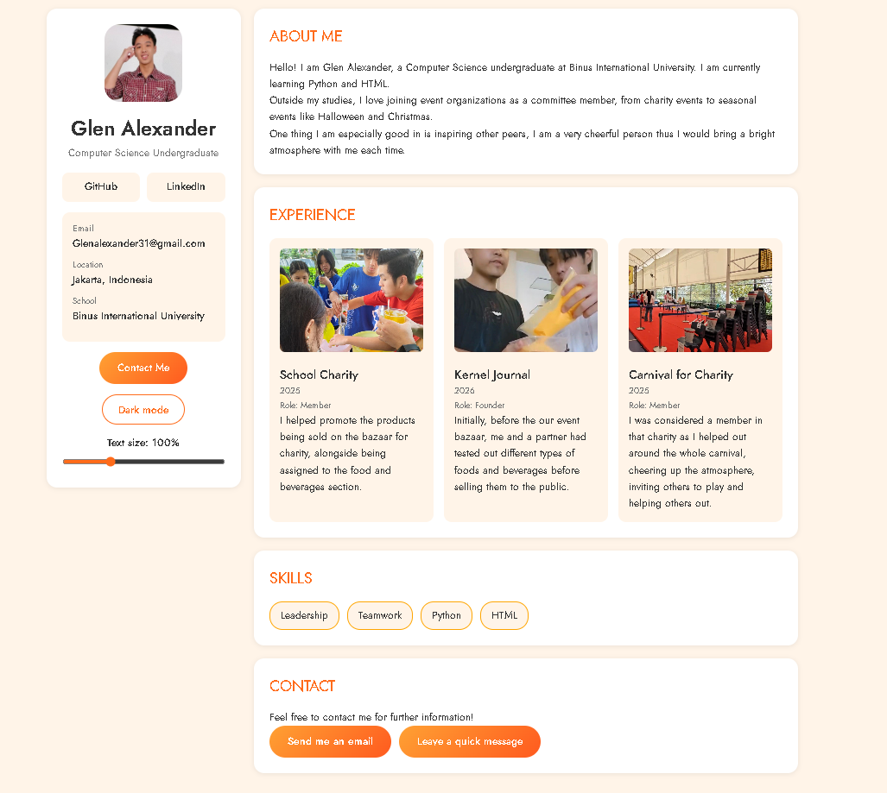

# Glen Alexander | Event Committee Portfolio

A single-page, responsive personal portfolio built for the Week 06 HCI lab assignment at Binus International University.



**Live site:** https://xanchezzz.github.io/HCI-PORTFOLIO-FINAL/
**Repository:** https://github.com/xanchezzz/HCI-PORTFOLIO-FINAL

## Purpose

The portfolio presents my participation and contributions in charity and event organizations. It is aimed at event recruiters who are looking for committee members.

## Sections

- **Sidebar:** profile photo, name, links, contact details, and the accessibility controls
- **About Me:** a short introduction
- **Experience:** cards for School Charity, Kernel Journal, and Carnival for Charity
- **Skills:** Leadership, Teamwork, Python, and HTML
- **Contact:** an email button and a quick message pop-up

## Features

- **JavaScript-built content:** the experience cards and skills are generated from data arrays instead of being written by hand in the HTML
- **Dark mode toggle:** switches between the light orange theme and a dark theme, and remembers the visitor's choice
- **Text size slider:** changes the text size from 80% to 150% while dragging, and remembers the setting
- **Message pop-up:** a form with name, email, and message fields, with error messages if something is missing or invalid; it closes with the × button, the Escape key, or a click outside the box
- **Responsive layout:** adapts to desktop, tablet, and mobile screens

## HCI Principles Applied

- **User control and accessibility:** visitors choose their own theme and text size
- **Feedback:** the buttons change on hover, the toggle text updates, and the form shows a confirmation message
- **Error prevention and recovery:** the form checks each field and explains how to fix a mistake
- **Consistency:** the buttons share one rounded style and the colors follow a single orange scheme
- **Keyboard support:** the pop-up can be closed with the Escape key and moves keyboard focus in and out

## Built With

- HTML
- CSS (Flexbox, media queries, Google Font: Jost)
- JavaScript (DOM manipulation, events, `localStorage`)

## Project Structure

```
HCI-PORTFOLIO-FINAL/
├── index.html           # Page structure (empty containers for cards and skills)
├── style.css            # Styling, dark mode, and responsive layout
├── script.js            # Portfolio data, cards, dark mode, text size, and message pop-up
├── profile.jpeg
├── school-charity.png
├── kernel-journal.png
├── carnival-charity.png
├── webview.png          # Screenshot used in this README
└── README.md
```

## How It Works

`script.js` stores the experiences in a `projects` array and the skills in a `skills` array. It loops through each one and inserts the generated HTML into the page. To add a new experience, add one more object to the `projects` array.

The dark mode and text size settings are saved in the browser with `localStorage`, so they stay the same after a refresh.

The message form has no server, so pressing Send opens the visitor's email app with the message already filled in.

## Run Locally

1. Clone the repository:
   ```
   git clone https://github.com/xanchezzz/HCI-PORTFOLIO-FINAL.git
   ```
2. Open the folder in VS Code.
3. Open `index.html` in a browser, or use the Live Server extension.

`index.html`, `style.css`, and `script.js` must stay in the same folder for the page to work.

## Author

**Glen Alexander**
Computer Science, Binus International University
Jakarta, Indonesia
